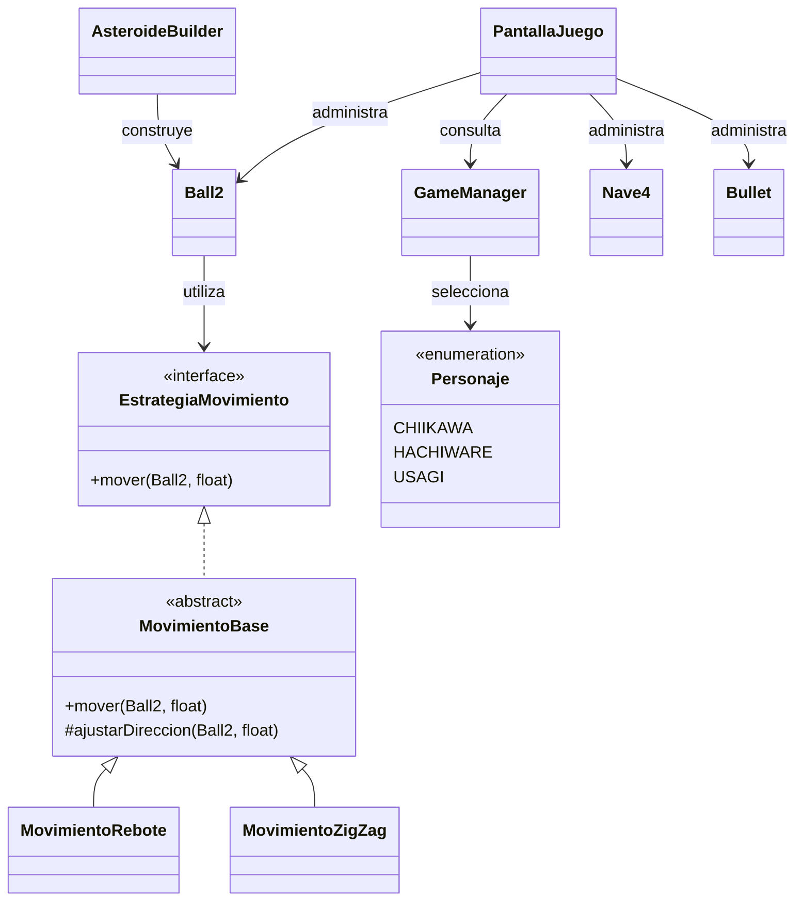

# Chiikawa Adventure

**Proyecto de Programación Avanzada — Primera entrega**  
**Base utilizada:** SpaceNav2024 (proyecto inicial proporcionado por el docente)  
**Tecnologías:** Java, LibGDX, Gradle y Eclipse  
**Integrantes:** [Nombre y apellido — completar]  
**Sección / docente / fecha:** [Completar]

> **Estado del proyecto:** primera versión de entrega. El código y los recursos del repositorio son la referencia definitiva de las funcionalidades incorporadas. Los campos entre corchetes deben completarse antes de entregar.

## 1. Descripción y propuesta de juego (GM-1)

**Chiikawa Adventure** es una adaptación de SpaceNav2024 con estética *kawaii* y *pixel art*, inspirada en los personajes Chiikawa, Hachiware y Usagi. El objetivo es sobrevivir a rondas de obstáculos móviles mientras el personaje seleccionado dispara proyectiles, evita colisiones y acumula puntos.

### Historia y ambientación

Chiikawa y sus amigos se enfrentan a una aventura en un mundo de tonos pastel. Los obstáculos representan los desafíos que deben superar; cada acierto permite progresar hacia nuevas rondas, que aumentan gradualmente su dificultad. El proyecto introduce una interpretación temática vinculada al ramo **Programación Avanzada** mediante el diseño de obstáculos rosados con ese nombre. **Comprobar en el código y los assets de la versión entregada si ese diseño ya reemplazó a todos los asteroides.**

### Objetivos y reglas

- Seleccionar uno de los tres personajes disponibles.
- Desplazarse para evitar los obstáculos.
- Disparar proyectiles hacia arriba para eliminarlos.
- Obtener **10 puntos por obstáculo destruido por un proyectil**.
- Superar rondas; al eliminar todos los obstáculos, comienza la siguiente, con mayor cantidad y velocidad.
- La partida termina cuando el personaje pierde todas sus vidas.
- Consultar el puntaje y el récord en la interfaz.

### Personajes

| Personaje | Vidas iniciales | Velocidad | Estilo de juego |
|---|---:|---:|---|
| Chiikawa | 3 | 320 | Equilibrado |
| Hachiware | 5 | 270 | Resistente, más lento |
| Usagi | 2 | 420 | Rápido, más frágil |

Las velocidades son valores de movimiento configurados en el juego, no kilómetros por hora.

### Controles

| Pantalla | Tecla | Acción |
|---|---|---|
| Menú principal | Enter | Ir a selección de personaje |
| Menú principal | Esc | Salir |
| Selección | 1 / 2 / 3 (incluye teclado numérico) | Elegir Chiikawa / Hachiware / Usagi |
| Selección | Esc | Volver al menú |
| Partida | W, A, S, D o flechas | Mover personaje |
| Partida | Espacio (mantener) | Disparar continuamente |
| Partida | P o Esc | Pausar o reanudar |

### Pantallas y evidencia gráfica

Agregar aquí capturas reales de la versión entregada:

| Pantalla | Archivo recomendado | Qué debe mostrar |
|---|---|---|
| Menú | `docs/capturas/menu.png` | Logo, instrucciones y fondo rosa |
| Selección | `docs/capturas/seleccion.png` | Tres personajes y sus estadísticas |
| Partida | `docs/capturas/partida.png` | Personaje, obstáculos, proyectiles, HUD y escenario |
| Pausa | `docs/capturas/pausa.png` | Partida detenida e indicación de pausa |
| Game Over | `docs/capturas/game-over.png` | Resultado final |

> Las imágenes de la tabla son **rutas sugeridas**, no archivos ya incluidos. Incorporar las capturas y, si se desea, mostrarlas con ``.

## 2. Análisis del juego base y cambios realizados (GM-2)

El punto de partida fue **SpaceNav2024**, con una nave, proyectiles, asteroides y diferentes pantallas. Se conservó la estructura general de juego para adaptar sus elementos y profundizar el diseño orientado a objetos.

| Aspecto | Base SpaceNav2024 | Chiikawa Adventure |
|---|---|---|
| Identidad visual | Juego espacial | Estética *kawaii* / *pixel art* |
| Personaje | Nave | Chiikawa, Hachiware y Usagi seleccionables |
| Atributos del jugador | Comportamiento general | Vidas y velocidades por personaje |
| Proyectiles | Cohete | Sprite personalizado de proyectil |
| Obstáculos | Asteroides grises | Movimiento por estrategias; diseño alternativo rosado preparado |
| Menú | Pantalla inicial | Logo personalizado, textos centrados y música |
| Escenario | Fondo oscuro | Paisaje pastel en imagen PNG |
| Sonidos | Recursos originales | Nuevos sonidos de lanzamiento e impacto |
| Estado de partida | Gestión inicial | `GameManager` centraliza puntaje y ronda |
| Creación de obstáculos | Construcción directa | `AsteroideBuilder` |
| Movimiento de obstáculos | Comportamiento original | Estrategias de rebote y zigzag |

### Historial de desarrollo

- **V1:** mejoras generales de movimiento, disparos, pausas, colisiones y rondas.
- **V2:** incorporación de `Strategy`, `Template Method` y `Singleton`.
- **V3:** incorporación de `Builder`.
- **V4:** selección entre tres personajes.
- **V5:** atributos diferenciados e integración de sprites.
- **V6:** menús personalizados, música, nuevos efectos, fondo y rediseño de proyectiles; diseño de obstáculos temáticos.

> El historial anterior resume la evolución conversada del proyecto. Los **commits reales** y sus fechas deben verificarse en GitHub.

## 3. Diseño orientado a objetos y UML (GM-3, GM-5)

El proyecto aplica clases con responsabilidades diferenciadas y encapsulación para separar presentación, estado, movimiento, configuración de entidades y manejo de recursos.

### Clases principales

| Clase | Responsabilidad |
|---|---|
| `SpaceNavigation` | Clase principal de LibGDX; administra pantallas y recursos generales |
| `PantallaMenu` | Menú principal |
| `PantallaSeleccion` | Selección de personaje e inicio de partida |
| `PantallaJuego` | Ciclo de juego, dibujo, rondas, colisiones y transiciones |
| `PantallaGameOver` | Pantalla de término de partida |
| `Personaje` | Enumeración de personajes y sus estadísticas |
| `Nave4` | Movimiento, disparo, vidas y daño del jugador |
| `Bullet` | Desplazamiento, representación y colisión de proyectiles |
| `Ball2` | Entidad de obstáculo, movimiento, dibujo y colisiones |
| `GameManager` | Estado compartido (puntaje, ronda y personaje seleccionado) |
| `AsteroideBuilder` | Construcción configurable de obstáculos |
| `EstrategiaMovimiento` | Contrato del movimiento de obstáculos |
| `MovimientoBase` | Secuencia general de movimiento (clase abstracta) |
| `MovimientoRebote` | Ajuste de dirección con rebote |
| `MovimientoZigZag` | Ajuste periódico de la dirección horizontal |
| `MusicaMenu` | Administración compartida de la canción entre menús |
| `Lwjgl3Launcher` | Punto de entrada de la aplicación de escritorio |

### Diagrama simplificado



**Nota sobre UML:** el diagrama es **conceptual** y deberá contrastarse con las firmas exactas del código fuente antes de usarlo como evidencia definitiva. La entrega académica debe incluir también el **UML completo**, con atributos, métodos, visibilidades, relaciones y componentes propios/de LibGDX, según corresponda.

### Clase abstracta e interfaz (GM-4)

- **Clase abstracta:** `MovimientoBase`; comparte el flujo de movimiento y deja un paso especializado a las subclases `MovimientoRebote` y `MovimientoZigZag`.
- **Interfaz:** `EstrategiaMovimiento`, que representa el contrato para mover obstáculos.
- **Uso efectivo:** `Ball2` recibe una estrategia de movimiento y delega en ella su actualización.

**Revisión importante para la pauta:** el uso descrito confirma una interfaz implementada a través de una clase base abstracta y dos subclases concretas; conviene verificar que la pauta acepte esta implementación como «dos clases que implementan una interfaz», o bien documentar explícitamente las implementaciones concretas según corresponda.

### Encapsulación (GM-5)

Los atributos sensibles se mantienen privados y se exponen mediante constructores, getters y métodos con propósito concreto. Por ejemplo, el puntaje cambia a través de `GameManager.sumarPuntos(...)` y las estadísticas de `Personaje` se consultan con sus getters. La pantalla no necesita modificar directamente los campos internos de cada objeto.

## 4. Patrones de diseño (GM-6 a GM-9)

### Singleton — GM-6

**Contexto:** varias pantallas requieren consultar o modificar el mismo estado de partida.  
**Problema:** duplicar el estado puede causar diferencias en puntaje, ronda o personaje elegido.  
**Solución:** `GameManager` expone una única instancia mediante `getInstance()`. Centraliza la selección del personaje y la gestión de puntaje/ronda.  
**Participantes:** `GameManager`, `PantallaSeleccion`, `PantallaJuego`.

**Evidencia:** `GameManager.java`, instancia privada y método `getInstance()`; llamadas desde las pantallas.

### Strategy — GM-7

**Contexto:** existen obstáculos con diferentes trayectorias.  
**Problema:** codificar todos los movimientos en `Ball2` con condicionales dificultaría la extensión.  
**Solución:** `EstrategiaMovimiento` define el contrato; `MovimientoRebote` y `MovimientoZigZag` representan comportamientos intercambiables. `Ball2` delega la actualización en la estrategia configurada.  
**Evidencia:** `EstrategiaMovimiento.java`, `Ball2.java`, `MovimientoRebote.java`, `MovimientoZigZag.java`.

### Template Method — GM-8

**Contexto:** varios movimientos comparten verificaciones y pasos comunes.  
**Problema:** repetir esa secuencia en cada variante aumenta el código duplicado.  
**Solución:** `MovimientoBase` organiza el algoritmo general mediante un método de plantilla y define un paso personalizable `ajustarDireccion(...)`, que especializan las subclases.  
**Evidencia:** `MovimientoBase.java` y sus clases derivadas.

### Builder — GM-9

**Contexto:** crear obstáculos requiere configurar posición, tamaño, velocidad, textura y estrategia.  
**Problema:** un constructor con muchos parámetros es menos legible y más propenso a errores de orden.  
**Solución:** `AsteroideBuilder` configura atributos mediante métodos encadenados (`posicion`, `tamano`, `velocidad`, `textura`, `estrategia`) y finaliza con `build()`.  
**Evidencia:** `AsteroideBuilder.java` y `PantallaJuego.crearObstaculos()`.

### Evidencia UML de patrones

Añadir cuatro diagramas separados, uno por patrón, con una explicación del **contexto, problema, solución y clases participantes**. Se sugieren estas ubicaciones:

- `docs/uml/singleton.png`
- `docs/uml/strategy.png`
- `docs/uml/template-method.png`
- `docs/uml/builder.png`

Estas rutas son propuestas: las imágenes deben agregarse al repositorio antes de enlazarlas.

## 5. Requisitos técnicos y ejecución

### Entorno

- **Lenguaje:** Java, con versión de JDK compatible con la configuración Gradle del proyecto (**verificar en `build.gradle` / archivos Gradle**).
- **Framework:** LibGDX.
- **IDE utilizado:** Eclipse.
- **Build:** Gradle.
- **Plataforma de ejecución documentada:** escritorio, mediante backend LWJGL3.

### Ejecutar desde Eclipse

1. Clonar o descargar este repositorio.
2. Importar el proyecto Gradle en Eclipse.
3. Esperar la sincronización y descarga de dependencias.
4. Verificar que el directorio de trabajo del launcher permita localizar los recursos de `assets`.
5. Ejecutar `Lwjgl3Launcher.java` en el módulo `lwjgl3`, mediante **Run As → Java Application**.
6. En el menú, presionar **Enter**, seleccionar un personaje con **1, 2 o 3**, y jugar.

**Si aparece `File not found: ... (Internal)`:** revisar que el recurso exista en `assets`, que su nombre y extensión coincidan con el código y que el directorio de trabajo esté configurado correctamente.

### Recursos utilizados

Entre los recursos incorporados o previstos en las versiones trabajadas se encuentran:

- `logo_chiikawa.png`: logo del menú.
- `chiikawa.png`, `hachiware.png`, `usagi.png`: personajes.
- `fondo_partida.png`: fondo pastel.
- `proyectil_estrella.png`: textura del proyectil (el diseño del sprite puede cambiar mientras se conserve la ruta).
- `musica_menu.mp3`: canción de menú y selección.
- `musica_partida.mp3`: canción exclusiva de la partida.
- `proyectil.wav`: efecto del disparo.
- `impacto.wav`: efecto cuando un disparo destruye un obstáculo.
- `hurt.ogg`: sonido de daño.
- `obstaculo_programacion.png`: **diseño propuesto; verificar integración efectiva**.

> **Créditos y licencias:** completar autor, procedencia, licencia y enlace de cada recurso gráfico y sonoro usado, especialmente los recursos externos. No asumir que todos los archivos descargados tienen permiso de redistribución.

## 6. Estructura del repositorio

La organización general sigue la estructura Gradle/LibGDX de SpaceNav2024:

```text
[raiz del repositorio]/
├── assets/                      # Imagenes y audio
├── core/                        # Codigo comun del juego
│   └── src/main/java/puppy/code/
├── lwjgl3/                      # Launcher de escritorio
├── [archivos Gradle]
├── README.md
└── docs/                        # Capturas y UML (agregar)
    ├── capturas/
    └── uml/
```

La ubicación exacta de cada módulo puede variar según cómo se haya importado/exportado el proyecto a Eclipse. Ajustar este árbol para que refleje las carpetas reales del repositorio.

## 7. Control de versiones — GitHub (GM-10)

Se planificó una evolución en **seis versiones (V1 a V6)**. La evidencia exigida no es esta enumeración, sino el **historial real de al menos seis commits** en GitHub.

**Completar antes de entregar:**

- **URL del repositorio:** `[pegar enlace]`
- **Rama de entrega:** `[main u otra]`
- **Integrantes/usuarios de GitHub:** `[completar]`
- **Enlace al historial:** `[pegar URL de /commits]`
- **Identificadores de seis commits:** `[pegar hashes abreviados o enlaces]`

## 8. Pruebas funcionales

Realizar y documentar al menos las siguientes verificaciones en la versión final subida al repositorio:

| Prueba | Resultado esperado | Estado |
|---|---|---|
| Abrir el programa | Aparece menú principal | [Pendiente de registrar] |
| Enter desde menú | Se abre selección; música continúa | [Pendiente de registrar] |
| Seleccionar cada personaje | Estadísticas y sprite correctos | [Pendiente de registrar] |
| Mover con WASD/flechas | Movimiento fluido | [Pendiente de registrar] |
| Mantener Espacio | Disparo repetido con sonido | [Pendiente de registrar] |
| Proyectil impacta | Desaparece obstáculo, suena impacto y suma 10 puntos | [Pendiente de registrar] |
| Colisión del personaje | Disminuyen vidas según la lógica de invulnerabilidad | [Pendiente de registrar] |
| P / Esc durante partida | Pausa y reanudación | [Pendiente de registrar] |
| Eliminar todos los obstáculos | Avanza la ronda | [Pendiente de registrar] |
| Perder todas las vidas | Aparece Game Over | [Pendiente de registrar] |
| Cambiar de selección a juego | Termina música del menú y empieza música de partida | [Pendiente de registrar] |

## 9. Entregables y evidencia pendiente

**Este README explica el proyecto, pero no reemplaza un informe separado si la pauta lo solicita.** Antes de enviar la primera entrega:

- [ ] Completar integrantes, sección, docente y fecha.
- [ ] Confirmar JDK/Gradle y árbol real del repositorio.
- [ ] Agregar capturas del menú, selección, partida, pausa y Game Over.
- [ ] Crear UML general, incluyendo las clases propias y la relación pertinente con LibGDX.
- [ ] Crear UML y justificaciones de los cuatro patrones.
- [ ] Confirmar que el requisito de interfaz y clase abstracta se ajusta a la interpretación de la pauta.
- [ ] Indicar en el informe archivos **y números de línea reales** para cada requisito.
- [ ] Comprobar que existan **al menos seis commits reales** subidos a GitHub.
- [ ] Verificar si el obstáculo rosado fue integrado; corregir la descripción si todavía es solo un asset.
- [ ] Registrar resultados de pruebas funcionales.
- [ ] Agregar créditos, licencias y enlaces de recursos externos.

## 10. Autoría y nota sobre los recursos

Proyecto académico desarrollado como modificación y extensión del material **SpaceNav2024**, facilitado por el docente, con fines educativos. **Chiikawa, Hachiware y Usagi** son personajes de una franquicia ajena a este proyecto. Esta adaptación no representa un producto oficial ni implica afiliación con los titulares de los derechos.

**Equipo:** [Completar nombres y contribuciones].
